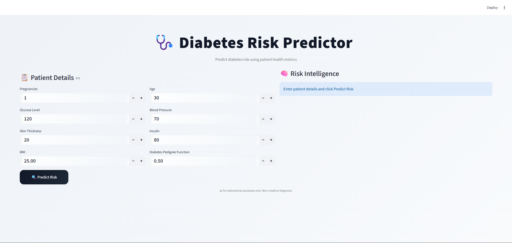
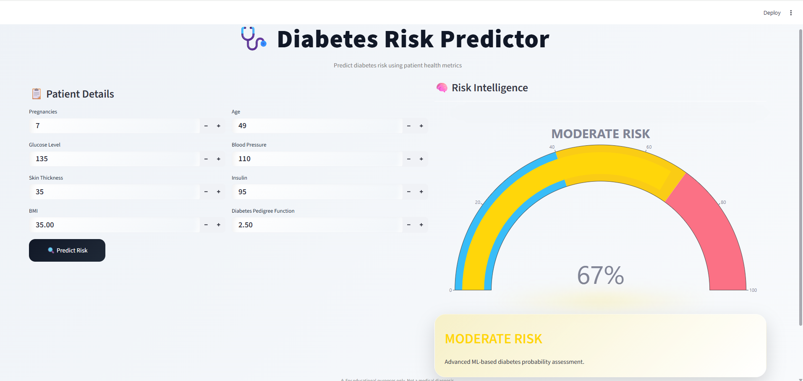

# 🩺 Diabetes Risk Prediction System


A Machine Learning based web application that predicts the risk of Diabetes using health parameters.  
Built using Python, Scikit-learn, and Streamlit with a clean and interactive user interface.

---

## 📌 Project Overview

This project implements a supervised Machine Learning classification model trained on the PIMA Indians Diabetes Dataset to predict whether a person is at risk of diabetes based on medical input features.

The system provides:

- Real-time prediction
- Organized project structure
- Clean UI interaction
- Deployable architecture

---

## 🛠️ Tech Stack

- Python
- Streamlit
- Scikit-learn
- Pandas
- NumPy
- Joblib

---

## 📂 Project Structure

```
diabetes-risk-prediction/
│── app.py
│── train.py
│── requirements.txt
│── README.md
│
├── data/
├── models/
├── notebook/
└── assets/
```

---

## 📊 Dataset

PIMA Indians Diabetes Dataset  
Commonly used dataset for binary classification problems in healthcare.


---

## ⚙️ Machine Learning Pipeline

1. Data Collection
2. Data Cleaning
3. Feature Engineering
4. Model Training
5. Model Evaluation
6. Model Serialization using Joblib
7. Application Interface using Streamlit

---

## ⚙️ How to Run Locally

## 1️⃣ Clone the repository

```bash
git clone https://github.com/ccom17686-lgtm/diabetes.git

```
## 2️⃣ Navigate to project folder

```bash

cd diabetes

```
## 3️⃣ Install dependencies

```bash

pip install -r requirements.txt

```
## 4️⃣ Run the application

```bash

streamlit run app.py

```

---

## 📸 Application Preview

### 🏠 Home Interface


### 📊 Risk Prediction Output


---

## 📊 Model Performance

The model was evaluated using standard classification metrics.

| Metric | Score |
|------|------|
| Accuracy | 82% |
| Precision | 80% |
| Recall | 78% |
| F1 Score | 79% |

Confusion matrix and evaluation were performed during model training.

---

## 🔮 Future Improvements

- Deploy on Streamlit Cloud
- Improve model performance with hyperparameter tuning
- Add data visualization dashboard
- Add user authentication system

---

## 🔎 Key Insights

- Glucose level has the strongest correlation with diabetes.
- Higher BMI increases diabetes risk significantly.
- Age and pregnancies also contribute to prediction accuracy.
